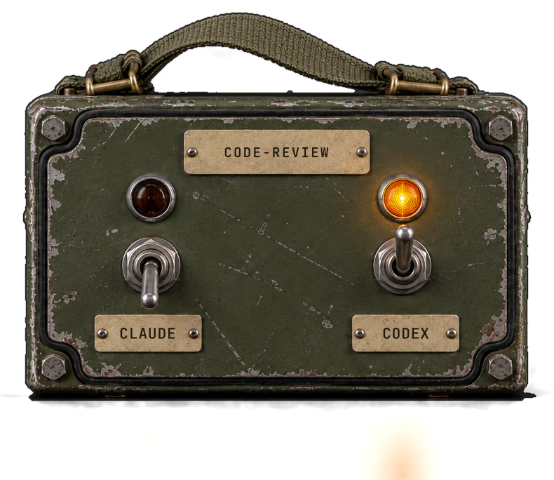
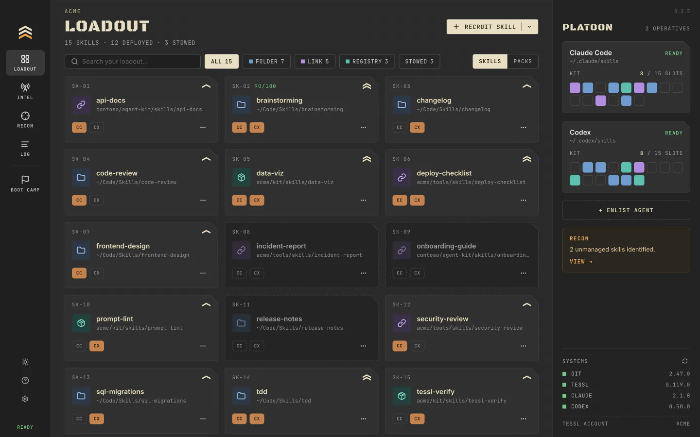

<p align="center">
  <a href="https://theloadout.dev/">
    
  </a>
</p>

<h3 align="center">One library of skills. One switch per coding agent.</h3>

<p align="center">
  <b>Loadout</b> is a Mac app that keeps your agent skills in one library<br>
  and gives each skill one switch per coding agent: Claude Code and Codex.
</p>

<p align="center">
  <a href="https://github.com/twiddr/loadout/releases/latest"></a>
  
  <a href="LICENSE"></a>
</p>

<p align="center">
  <a href="https://theloadout.dev/"><b>Download page</b></a> ·
  <a href="#deploy-install-loadout">Install</a> ·
  <a href="#boot-camp-first-steps">First steps</a> ·
  <a href="#field-manual">Field manual</a> ·
  <a href="https://github.com/twiddr/loadout/issues">Report a bug</a>
</p>

## Mission

You write skills, you download skills, and every coding agent wants them in its own folder. Loadout keeps one library and flips one switch per skill per agent.

- **One library.** Every skill is one entry in `~/.loadout/skills`, wherever the skill itself lives: a folder of your own, a GitHub repository or a Tessl plugin.
- **One switch per agent.** On creates one link in that agent's skills folder. Off removes the link. That is all a switch does.
- **Nothing gets deleted.** Loadout only adds and removes links. It never deletes a skill folder, and it moves skills it finds in your agent folders to a backup before it takes them over.

<p align="center">
  
  <br>
  <sub>The Loadout page with sample skills. Orange CC and CX boxes are switches that are on.</sub>
</p>

### Standing orders

| Order       | What Loadout does                                                                                             |
| ----------- | ------------------------------------------------------------------------------------------------------------- |
| **Recruit** | Adds a skill from a GitHub repository (Link), a folder on your Mac (Folder) or the Tessl registry (Registry). |
| **Deploy**  | Switches a skill on or off for Claude Code and Codex, one skill at a time or a whole pack at once.            |
| **Intel**   | Checks your Link and Registry skills for updates when you ask, and applies them.                              |
| **Recon**   | Finds skills already in your agent folders and takes them over, with a backup of each original.               |
| **Fork**    | Copies any skill to a folder of your own under a new name, so you can change it.                              |
| **Tessl**   | Reviews, fixes and publishes your own skills with the `tessl` CLI. Optional.                                  |
| **Log**     | Shows the output of every `git` and `tessl` command that Loadout runs.                                        |

## Requisition: what you need

| Kit                      | When                                    | Install                                                             |
| ------------------------ | --------------------------------------- | ------------------------------------------------------------------- |
| A Mac with Apple silicon | Always                                  | Loadout is built for `arm64` only. It does not run on an Intel Mac. |
| `git`                    | Always                                  | `xcode-select --install`, or `brew install git`                     |
| Claude Code, Codex       | At least one of them                    | See the commands below                                              |
| Tessl                    | Only for Registry, Review, Fix, Publish | See the commands below                                              |

<details>
<summary><b>Install commands for Claude Code, Codex and Tessl</b></summary>

- **Claude Code:** `curl -fsSL https://claude.ai/install.sh | bash`, or with Homebrew `brew install --cask claude-code`. Then run `claude auth login`.
- **Codex:** `curl -fsSL https://chatgpt.com/codex/install.sh | sh`, or with Homebrew `brew install --cask codex`. Then run `codex login`.
- **Tessl:** `curl -fsSL https://get.tessl.io | sh`, or with Homebrew `brew tap tesslio/tap`, `brew trust tesslio/tap`, `brew install tesslio/tap/tessl`. Then run `tessl login`.

Loadout reads your shell's `PATH` and also looks in `~/.local/bin`, `/opt/homebrew/bin` and `/usr/local/bin`, so a launch from Finder finds tools installed by these installers. If you install a tool while Loadout is open, press Refresh (the icon in SYSTEMS).

</details>

## Deploy: install Loadout

1. In Terminal, run:

   ```bash
   curl -fL -o ~/Downloads/Loadout.dmg https://github.com/twiddr/loadout/releases/latest/download/Loadout.dmg
   ```

2. Open `Loadout.dmg` in your Downloads folder, drag Loadout to Applications, and eject the Loadout disk.
3. Start Loadout from `/Applications`.

> [!TIP]
> To check a download, compare `shasum -a 256 ~/Downloads/Loadout.dmg` with the SHA-256 in the notes of the [latest release](https://github.com/twiddr/loadout/releases/latest). The [download page](https://theloadout.dev/) shows it too.

<details>
<summary><b>Downloaded <code>Loadout.dmg</code> in a browser?</b></summary>

macOS blocks the first launch of a copy downloaded in a browser.

1. Open `Loadout.dmg`, drag Loadout to Applications, and eject the Loadout disk.
2. Start Loadout. The first launch stops with **"Loadout.app" Not Opened** and only the buttons Done and Move to Bin. Press Done.
3. In Terminal, run:

   ```bash
   xattr -dr com.apple.quarantine /Applications/Loadout.app
   ```

4. Start Loadout again.

On macOS 27.2, right-click › Open and Open Anyway in System Settings did not get past this message; the `xattr` command does.

</details>

## Boot camp: first steps

1. **Start Loadout.** BOOT CAMP opens at the first launch, when no agent is enlisted. It checks the agents, git and Tessl. The Briefing, five cards that explain the ideas behind Loadout, opens over it. SKIP BRIEFING or <kbd>Esc</kbd> closes it, and the `?` button in the rail opens it again.
2. **Enlist your agents.** Enlist Claude Code, Codex or both with the ENLIST switch. If a tool is missing, its row shows the install command with COPY and OPEN TERMINAL. Run the command, then press CHECK AGAIN.
3. **Go to Recon.** GO TO RECON appears once one agent is enlisted. The Recon page lists the skills that are already in your agent folders. With no such skill, the button is GO TO LOADOUT.
4. **Recruit a skill.** On the Loadout page, press Recruit skill:
   - **Link** takes a GitHub repository, such as `anthropics/skills`.
   - **Folder** takes a folder that holds a `SKILL.md`.
   - **Registry** takes `workspace/plugin`, typed or picked from the field's dropdown, which lists the plugins of the chosen Tessl workspace.
5. **Switch it on.** Switch an agent toggle on. Loadout links `~/.claude/skills/<name>` (or `~/.codex/skills/<name>`) to `~/.loadout/skills/<name>`. Switch it off to remove the link.
6. **Take over what you had.** The Recon page lists what was in your agent folders before Loadout. To put one of these skills under Loadout's switches, press RECRUIT on its row. Loadout changes nothing there until you do.

Tessl is optional. To use it, run `tessl login` in Terminal, then choose the default workspace in Settings.

## Field manual

The rail on the left has five pages: BOOT CAMP, Loadout, Intel, Recon and Log. The back button on a mouse returns to the page you saw before. Open a section for the details.

<details>
<summary><b>Loadout page: cards, packs and the card menu</b></summary>

- **Cards.** One card per skill, sorted by name, with a search box and the filter chips All, Folder, Link, Registry and Stowed. A card shows the source, one toggle per enabled agent, and the `⋯` menu.
  - Folder is `local`: a folder of your own, edited in place.
  - Link is `github`: a clone under `~/.loadout/repos`.
  - Registry is `tessl`: a plugin under `~/.tessl/plugins`.
- **Card states.** A stowed card is a skill that no agent uses. A card for a skill whose folder is gone shows MISSING. A card for a library entry that is not a link shows NOT A LINK.
- **Packs.** The `SKILLS | PACKS` button at the end of the filter row switches to the packed view, and Loadout remembers the choice. There, a Link or Registry source with two or more skills shows as one pack card. Its agent box deploys every skill of the pack to that agent, or stows them all when all are deployed; lines in the box mean that some are deployed. The pack's `⋯` menu has Check source, Update, Reveal in Finder and Remove. Remove takes every skill of the pack out of your loadout; the clone or plugin folder stays on disk. Click a pack to see its skills as normal cards; `‹ PACKS` or the mouse Back button returns to the grid. A search, or the Stowed chip, shows every skill as its own card.
- **Card menu (`⋯`).**
  - Check: looks for an update to the skill's source (Link and Registry only).
  - Update: pulls the clone or reinstalls the plugin, for every skill from that source.
  - Tessl review: the `tessl` review score.
  - Tessl fix: one improve-and-review round, which costs 100 credits times the model multiplier (Folder only).
  - Tessl publish (Folder only) and Tessl unpublish (Folder skills with a Tessl manifest).
  - Fork: see "Fork a skill" below.
  - Reveal in Finder.
  - Remove: removes the agent links and the library link. The skill folder stays on disk.

</details>

<details>
<summary><b>Skill page</b></summary>

Click a card to open it. The skill page shows the rendered `SKILL.md` (Briefing), the Diff of a pending update and the commit History for a Link skill, the agents the skill is deployed to, its spec and its files. Decommission skill removes it.

</details>

<details>
<summary><b>Tessl: status, publish and unpublish</b></summary>

**Status.** A Folder skill with a Tessl manifest (`.tessl-plugin/plugin.json`) shows a `package` mark beside its rank chevron. The tooltip names the plugin (`<workspace>/<plugin>`) and the manifest version.

- When you edit the skill after its last publish, the mark turns amber and pulses, and the tooltip says `Changed since publish`: a file in the folder is newer than the manifest, which Tessl rewrites at every publish. Publish the skill to clear it. An edit you undo still counts until the next publish.
- The skill page then shows an amber strip, `Files changed after version <version> was published.`, with PUBLISH. Hover the sentence to see which files.
- The skill page has a TESSL card: PLUGIN, MANIFEST, REGISTRY, VISIBLE, OPEN IN REGISTRY (the plugin's registry page in your browser) and SHARE (copies a message for a colleague with the registry link and the install line).
- A Registry skill's page has the same card, read from the installed plugin, with INSTALLED in place of MANIFEST and none of the publish strips.
- The refresh button beside REGISTRY runs `tessl plugin info` and shows the published date and version. When the versions differ, a strip says which copy is behind: folder ahead offers PUBLISH; registry ahead asks you to bring the newer copy into the folder first.
- Other states: PENDING (Tessl still checks a new version), NOT FOUND, ARCHIVED, DEPRECATED and CHECK FAILED (with Tessl's message, for example when you are logged out).
- Loadout looks up the registry only from the refresh button, after a Publish and during a Tessl unpublish. It stores nothing and forgets the result when it quits.

**Publish.** The dialog offers the workspace, the bump (patch, minor, major) and, only when the skill folder is in a git work tree, COMMIT MANIFEST, which commits the manifest and nothing else. The result reads `published <version>`, and Loadout then checks the registry. If Tessl still checks the new version, REGISTRY shows PENDING, and Loadout checks again 20, 40 and 60 seconds later.

**Unpublish.**

> [!CAUTION]
> Unpublish cannot be undone. Tessl says unpublished versions "are completely removed and cannot be recovered". A colleague who installed the plugin keeps a working copy but cannot update or reinstall it.

The card `⋯` menu and the ACTIONS menu on the skill page offer it for a Folder skill with a Tessl manifest. The dialog names the plugin and runs nothing until you press Unpublish; the job then removes every version of the plugin it can find. When every version is gone, Loadout deletes the Tessl manifest (`.tessl-plugin/plugin.json`, and the folder when it is empty), so the skill no longer shows as published. In a git folder you commit that deletion yourself. A new Publish starts the plugin again at version 0.1.0. The result reads `unpublished <versions>`. A version Loadout cannot find, and Archive (`tessl plugin archive --plugin <workspace>/<plugin> --reason <text>`), are steps for the `tessl` CLI.

</details>

<details>
<summary><b>Intel, Recon and Log</b></summary>

- **Intel:** the sources with an update. Check all looks for updates, and Update all applies every update that is ready.
- **Recon:** links and folders in an agent's skills folder that Loadout did not make, and problems with skills in your loadout.
  - RECRUIT on a row shows every step first, then adds the skill to your loadout, switches it on for that agent and moves your original, unchanged, to `~/.loadout/backups/<agent>/<name>`.
  - MOVE TO BACKUP does the move alone, for a link whose target is gone.
  - The BACKUPS section lists the originals. REVEAL opens one in Finder and UNDO moves it back to the agent folder.
  - Loadout never deletes an original or a backup. Remove a backup in Finder when you no longer need it.
  - Rescan reads the folders again.
- **Log:** the output of every `git` and `tessl` run. While a command runs, a bar shows the command and Cancel, which stops it. A failed filter shows only failed runs, the copy button on a run puts its command and output on the clipboard, and Clear empties the list.

</details>

<details>
<summary><b>Platoon panel, appearance and Settings</b></summary>

- **Platoon panel:** the enabled agents, the SYSTEMS list and the Recon count.
- **Appearance:** Loadout starts dark. The sun or moon button at the bottom of the rail switches between light and dark. Settings also offers System, which follows macOS. Loadout keeps the choice in `~/.loadout/config.json`.
- **Settings** (the gear at the bottom of the rail, or `+ Enlist agent`): the agents, your Tessl account and workspaces, the appearance, the tools Loadout found with their paths and versions (Refresh checks again), and the folders Loadout uses, each with Reveal in Finder.

</details>

<details>
<summary><b>Fork a skill</b></summary>

Fix and Publish work on Folder skills (`local`) only. To change a Link (`github`) or Registry (`tessl`) skill, or to make any skill your own under a new name, fork it:

1. Open the `⋯` menu on the card (or ACTIONS on the skill page) and choose Fork.
2. Type the new name and press Choose folder…. Pick the parent folder. The copy goes to `<parent folder>/<new name>`, and Loadout adds it as a Folder skill.
3. The agents that had the original on switch to the fork. The original stays in your loadout and on disk, switched off for those agents.

The copy leaves out `.git`, `node_modules`, `__pycache__` and `.DS_Store` at any depth, and the Tessl files `.tessl-plugin/`, `tile.json` and `tessl-package.json` at the folder root, so a Publish of the fork makes a new plugin. Fork changes only the `name` line in the frontmatter of the copy's `SKILL.md`. The result lists every other line that names the original; edit those by hand where they should name the fork. A saved review or fix does not carry over.

> [!IMPORTANT]
> Fork has no undo. To take a fork back, remove it in Loadout and delete its folder by hand, then switch the original on again.

A fork of a skill in a subfolder of a GitHub repository leaves out the repository's `LICENSE`. Check the licence before you publish someone else's skill.

</details>

<details>
<summary><b>Out of bounds: skills Loadout does not manage</b></summary>

- **Plugin skills** (Claude Code `/plugin`, Codex `/plugins`) live in the plugin folders, not in the agent skills folders. The agent's plugin manager installs, updates and removes them; Loadout does not show them.
- **`~/.claude/skills/synced`** is the claude.ai skill sync. Claude Code loads those skills as `anthropic-skills:<name>`, whatever the Loadout switches say. Recon lists them under the `synced` row, read-only, and marks each name that is also in your loadout `IN LOADOUT`. A skill in your loadout that is also synced carries a cloud icon on its card and a CLAUDE.AI card on its skill page, which says whether the two copies are the same. Loadout shows the `"skillOverrides"` and `"syncClaudeAiSkills": false` lines to copy into `~/.claude/settings.json`; it never writes that file. Change the synced skills themselves on claude.ai.
- **A skill that runs a CLI** (for example `human-review`, `extract-design`) needs that CLI on your machine; Loadout does not check or install it. If the skill runs `npx <cli>`, a global install pins the version `npx` runs, so update it with the skill or leave it out. Do not run a vendor's setup command (such as `npx human-review setup --global`) for a skill Loadout manages: it writes through Loadout's links into the clone. Or let the CLI install the skill instead of Loadout (for example `human-review setup --global`): it then shows on the Recon page, and you update it with the CLI. Delete any copy it writes into `~/.agents/skills`, because Codex would load it twice.

</details>

## Supply lines: updates

**Loadout itself.** At each start, Loadout checks GitHub once for a newer release: one `curl` request to `github.com`. It needs no account and stores nothing. When a newer release exists, the window corner shows the two versions and `UPDATE ›`, for example `0.1.4 → 0.1.5 UPDATE ›`.

**Your skills.** A check runs only when you press Check on a skill or Check all on the Intel page. Loadout never checks skills in the background. Results last until Loadout quits. A clone with local edits or rewritten history shows BLOCKED, and Loadout does not update it.

<details>
<summary><b>How the app update works</b></summary>

- While Loadout stays open, it checks again once a day at 12:00 local time, or when the Mac wakes between 12:00 and 18:00 after a missed 12:00, but never within 1 hour of another check and never in the evening or at night. A failed check writes one line to the Log and shows nothing else.
- `Loadout › Check for Updates…` checks on request and says when you have the latest release.
- `UPDATE ›` opens a dialog. DOWNLOAD gets the new release, checks it and gets it ready. A progress line shows `DOWNLOADING <version>` and the percent, then `CHECKING <version>`. CANCEL stops the download. CLOSE hides the dialog and the download goes on; `UPDATE ›` shows it again.
- When the update is ready, the dialog shows `<version> IS READY` and RESTART. Loadout restarts only when you press RESTART. If a command is running, RESTART says `Another command is running.` and Loadout stays open; press it again when the command has ended. A normal quit installs nothing.
- If Loadout cannot write its own folder, the dialog offers no DOWNLOAD and opens the steps under INSTALL BY HAND ›. The same happens when an update fails: the dialog shows the reason and opens the steps, and TRY AGAIN starts the download again. The steps are the install steps above: download `Loadout.dmg` with `curl`, quit Loadout, drag Loadout to Applications and replace the old copy, eject the Loadout disk, then start Loadout.

</details>

## Stores: where Loadout keeps things

| Path                     | What it holds                                            |
| ------------------------ | -------------------------------------------------------- |
| `~/.loadout/config.json` | The agents, the Tessl workspaces and the appearance.     |
| `~/.loadout/skills`      | The library, one link per skill.                         |
| `~/.loadout/repos`       | The clones made by Recruit skill › Link.                 |
| `~/.loadout/backups`     | The originals that Recon moved out of agent folders.     |
| `~/.tessl/plugins`       | The plugins Tessl installs for Recruit skill › Registry. |

## Fine print

- **Licence.** Loadout is under the MIT licence; see [`LICENSE`](LICENSE). The bundled fonts and icons keep their own licences; see [`THIRD_PARTY_NOTICES.md`](THIRD_PARTY_NOTICES.md).
- **Bugs and security.** Loadout is open source, but not open to contributions: pull requests are turned off. Bug reports are welcome as [Issues](https://github.com/twiddr/loadout/issues). Report a security problem privately, as [`SECURITY.md`](SECURITY.md) describes. To change Loadout for yourself, fork it; the licence allows that.
- **Trademarks.** Loadout is an independent project. It is not affiliated with, endorsed by or sponsored by Anthropic (Claude Code, claude.ai), OpenAI (Codex), Tessl, OpenCode, GitHub or Homebrew. Their names appear here only to say which tools Loadout works with.

<details>
<summary>Build Loadout from source</summary>

Needs Node.js and pnpm.

```bash
pnpm install
pnpm dev        # run the app
pnpm package    # ad-hoc signed dist/mac-arm64/Loadout.app and dist/Loadout.dmg
```

If Electron does not start after `pnpm install`, run `node node_modules/electron/install.js` once.

</details>

<p align="center">
  <br>
  <a href="https://theloadout.dev/"></a>
  <br>
  <sub><a href="https://theloadout.dev/">theloadout.dev</a></sub>
</p>
